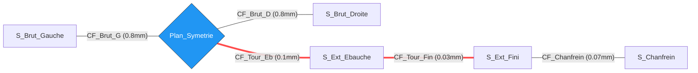

# ⚙️ Anselmetti Studio : Moteur de Transfert de Cotes

Cette application numérise le calcul des transferts de cotes et des chaînes de tolérances (méthode Anselmetti), une étape indispensable en génie mécanique pour valider une gamme d'usinage.

L'outil s'appuie directement sur les méthodologies d'empilage vectoriel et de décomposition des cotes (cotes machines $C_m$, cotes outils $C_o$) enseignées dans le manuel de référence ***Guide du technicien en productique* (A. Chevalier & J. Bohan)**. L'enjeu métier est de garantir mathématiquement que la succession des opérations de retrait de matière respecte les intervalles de tolérance (IT) fonctionnels exigés par le plan client.

## 📖 Concepts Métier (Méthode Anselmetti)
* **IT (Intervalle de Tolérance) :** Marge d'erreur géométrique autorisée par l'usinage.
* **CF (Cote de Fabrication) :** L'opération d'usinage physique reliant deux états de la matière.
* **CC (Cote Condition) :** Le besoin fonctionnel client, validé si l'empilage des IT de fabrication reste inférieur à l'IT condition.

## 🕸️ Tracé Vectoriel
L'algorithme parcourt les Cotes de Fabrication pour relier les surfaces d'une Cote Condition :



## 🛠️ Stack Technique

*   **uv** : Gestionnaire d'environnements et de dépendances Python ultra-rapide.
*   **Marimo** : Environnement réactif (reactive notebook) permettant l'interface UI, le calcul dynamique et l'export direct en WebAssembly (WASM) pour hébergement statique.
*   **Streamlit** : Framework alternatif abordé pour le prototypage rapide de l'interface métier.
*   **DuckDB** : Moteur SQL in-memory exécutant les jointures dynamiques entre le parc machine/outils et la gamme opératoire.
*   **NetworkX** : Moteur de théorie des graphes résolvant les chaînes de cotes (algorithme du plus court chemin).
*   **Mermaid.js** : Génération native des diagrammes de séquence (déroulé métier) et des flowcharts (tracé vectoriel Anselmetti).

## 🚀 Setup & Lancement Local

Prérequis : Avoir installé `uv` sur sa machine.

```bash
# 1. Synchroniser l'environnement et installer les dépendances (pandas, networkx, duckdb, marimo, streamlit)
uv sync

# 2. Lancer l'application en mode Marimo (Version principale)
uv run marimo edit app.py

# 3. (Alternative) Lancer l'application en mode Streamlit si le prototype a été conservé
uv run streamlit run app_streamlit.py
```